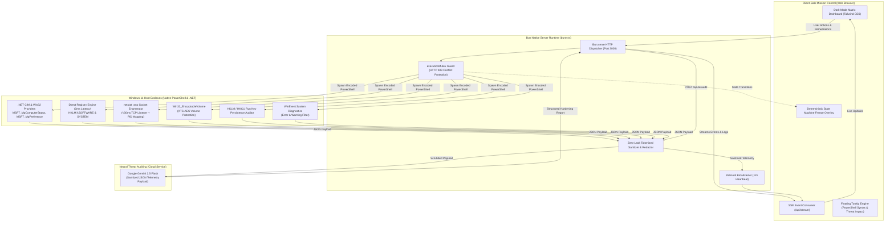
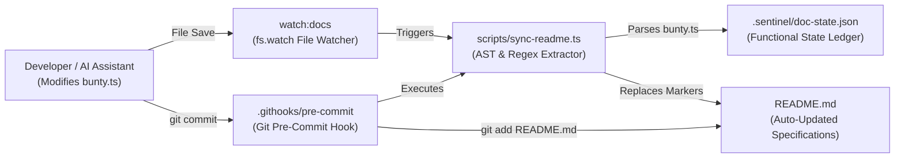

# ⚡ Windows 11 Sentinel // Live Mission Control Center

<div align="center">

[](https://bun.sh)
[](https://microsoft.com)
[](bunty.ts)
[](bunty.ts)
[](bunty.ts)
[](bunty.ts)
[](LICENSE)

<br/>

**Ultra-Fast Windows 11 Sentinel: Autonomous Host Hardening, Kernel Enclave Auditing, and Zero-Leak Neural Security Synthesis in a Single TypeScript File.**

[Quick Start](#-quick-start) • [System Architecture](#-system-architecture) • [Live Specifications](#-live-system-specifications) • [Autonomous Doc Engine](#-autonomous-documentation-engine) • [API & Endpoints](#-rest--sse-api-specification)

</div>

---

## 📋 Executive Overview

**Windows 11 Sentinel** (`bunty.ts`) is a mission-critical, self-contained host defense workstation. Unlike bloated endpoint management agents that consume gigabytes of memory and require complex multi-service daemons, Sentinel compiles directly into **Bun's ultra-lean runtime** and executes as a **single, zero-dependency TypeScript file**.

It couples a native **sub-500ms PowerShell + .NET CIM / Win32 query engine** with a high-throughput **Server-Sent Events (SSE) loopback stream** and an interactive, dark-mode cybernetic dashboard. Operators gain real-time visibility into Windows 11 kernel enclaves, active socket listeners, autorun persistence vectors, BitLocker volume encryption, and algorithmic security posture scoring.

### 🌟 Core Architectural Pillars

- ⚡ **Sub-500ms Telemetry Engine**: Bypasses slow WMI providers wherever possible, reading CPU, GPU, BIOS, OS builds, and memory allocations via zero-stall direct Registry queries and compiled `.NET ComputerInfo` / `DriveInfo` structures.
- 🔒 **Deterministic State Machine Mutex**: Guarantees atomic command idempotency. During script dispatch, a global glass freeze overlay isolates the UI, preventing concurrent mutation races.
- 📡 **Live SSE Loopback Terminal**: Dispatches child PowerShell processes through base64-encoded UTF-16LE IPC pipes, sanitizes CLIXML progress streams, and streams stdout/stderr to the browser in real time.
- 🛡️ **Zero-Leak Data Scrubber**: All outbound telemetry, log lines, and AI payloads are scrubbed of usernames, home directories, Google Gemini API tokens, Bearer session secrets, and hardware MAC addresses before transmission.
- 🤖 **Neural Threat Auditing**: Couples machine telemetry with Google Gemini 2.5 Flash to synthesize host-specific risk analyses and generate exact hardening commands.
- ↺ **Atomic 1-Click Rollback Registry**: Every remediation script is paired with an inverted, idempotent rollback command, allowing operators to revert changes instantly without downtime.
- 🔄 **Autonomous Documentation Engine**: Every functional change made to `bunty.ts` automatically updates this `README.md` and the machine-readable state ledger via git pre-commit hooks and file watchers.

---

## 🏛️ System Architecture

The following diagram illustrates the unidirectional data flow, IPC mechanics, and security boundaries implemented in `bunty.ts`:



---

## 📊 Live System Specifications

<!-- AUTOGEN:STATS_START -->
| Metric | Specification |
| :--- | :--- |
| **Architecture** | Single-File Zero-Dependency TypeScript (`bunty.ts`) |
| **Runtime Engine** | Bun `v1.4+` (Native Web Standard APIs & IPC) |
| **Source Footprint** | **2621 lines** (`122.2 KB`) |
| **Telemetry Velocity** | **< 500ms** (Compiled .NET + CIM / Direct Registry) |
| **Network Socket Radar** | **< 30ms** (`netstat -ano` + PID mapping) |
| **Real-Time IPC** | Server-Sent Events (SSE) Loopback Stream |
| **Engine SHA-256** | `a2964ebff1b570db` |
| **Last Synchronized** | `2026-10-28 15:51:30 UTC` |
<!-- AUTOGEN:STATS_END -->

---

## ⚙️ Environment Configuration

The tool initializes with zero configuration by default, automatically binding to `localhost:3000` and auto-launching the default Windows browser. Configure behavior using the following environment variables:

<!-- AUTOGEN:ENV_START -->
| Variable | Default Value | Description |
| :--- | :--- | :--- |
| `PORT` | `3000` | TCP port for the Mission Control HTTP and SSE server (Default: 3000) |
| `HOST` | `localhost` | Binding host address (Default: localhost) |
| `GEMINI_API_KEY` | `(None)` | Google Gemini API key for neural threat analysis (Optional, can also be provided in UI) |
| `GEMINI_MODEL` | `gemini-2.5-flash` | Google Gemini model tag for threat auditing (Default: gemini-2.5-flash) |
| `AUTO_LAUNCH` | `(Computed)` | Auto-launch default browser on startup (Set 'false' to disable) |
| `NO_BROWSER` | `(Computed)` | Alternative flag to inhibit browser auto-launching (Set '1' to disable) |
| `CI` | `(Computed)` | CI environment flag (Inhibits browser auto-launch when set) |
| `SCRUB_TELEMETRY` | `(Computed)` | Toggle zero-leak telemetry scrubber (Set 'false' to bypass redaction; Default: true) |
| `USERNAME` | `(Computed)` | Windows current operator username (Scrubbed in outbound telemetry) |
| `USER` | `(Computed)` | Runtime environment flag USER |
| `LOGNAME` | `(None)` | Runtime environment flag LOGNAME |
| `USERPROFILE` | `(Computed)` | Windows user profile directory (Scrubbed in outbound telemetry) |
| `HOME` | `(None)` | Runtime environment flag HOME |
<!-- AUTOGEN:ENV_END -->

---

## 🔌 REST & SSE API Specification

`bunty.ts` exports a unified HTTP and Server-Sent Events API. All endpoints enforce zero-leak sanitization and deterministic state locking:

<!-- AUTOGEN:ENDPOINTS_START -->
| Route | Method | Classification | Description |
| :--- | :---: | :--- | :--- |
| `/` | `GET` | Frontend Asset | Dashboard Landing Page |
| `/app.js` | `GET` | Frontend Asset | Client Application Bundle |
| `/api/stream` | `GET` | REST / IPC | Server-Sent Events (SSE) Loopback Stream |
| `/api/telemetry` | `GET` | REST / IPC | Telemetry Endpoint |
| `/api/remediate` | `POST` | REST / IPC | Remediation Execution Endpoint (Atomic Mutex Guarded) |
| `/api/ai-audit` | `POST` | REST / IPC | Gemini AI Neural Threat Audit Endpoint |
<!-- AUTOGEN:ENDPOINTS_END -->

### Real-Time SSE Stream Events (`/api/stream`)

The persistent Server-Sent Events stream emits the following typed event channels:

| Event Channel | Payload Schema | Description |
| :--- | :--- | :--- |
| `connected` | `{"status": "STREAM_ONLINE", "time": number}` | Initial handshake confirmation emitted upon socket connection. |
| `ping` | `{"time": number, "activeClients": number}` | Heartbeat pulse emitted every 12 seconds to prevent NAT timeout. |
| `telemetry_update` | Full sanitized telemetry JSON object | Pushed on initial connection, post-remediation, or after host scans. |
| `state_transition` | `{"state": "EXECUTING" \| "SETTLED_SUCCESS" \| "SETTLED_FAILURE", "actionId": string, ...}` | Signals UI state machine locks and unlocks for atomic isolation. |
| `terminal_log` | `{"type": "stdout" \| "stderr" \| "state" \| "success" \| "error", "text": string}` | Streams raw PowerShell IPC output lines directly to the browser console. |

---

## 🎯 Security Posture Scoring Algorithm

The host posture score is calculated deterministically across 10 security enclaves. The algorithm assigns weights based on real-world threat velocity (ransomware execution, LSASS memory dumping, NTLM relaying, and adware bundlers):

<!-- AUTOGEN:POSTURE_START -->
The security posture algorithm evaluates 10 key Windows 11 defense rings starting from a base baseline of **25 points** up to a maximum of **100/100 points**:

| Defense Vector | Evaluation Condition | Posture Points |
| :--- | :--- | :---: |
| **Base Baseline** | Minimum host operational baseline | `+25` |
| **Microsoft Defender Real-Time Protection Active** | `$rtp` | `+15` |
| **Microsoft Defender Tamper Protection Armed** | `$tp` | `+10` |
| **Hypervisor-Protected Code Integrity (HVCI) Running** | `$hvciRunning` | `+10` |
| **Virtualization-Based Security (VBS) Running** | `$vbsRunning` | `+5` |
| **LSA RunAsPPL Credential Guard Enabled** | `$lsaPPL` | `+10` |
| **Legacy SMBv1 Protocol Disabled** | `-not $smb1Enabled` | `+5` |
| **SMB Packet Signing Required** | `$smbSigning` | `+5` |
| **LLMNR Multicast Spoofing Resolution Disabled** | `$llmnrDisabled` | `+5` |
| **Defender PUA / PUP Adware Protection Enforced** | `$pua` | `+15` |
| **Maximum Posture Score** | All defense vectors active and hardened | **100** |
<!-- AUTOGEN:POSTURE_END -->

---

## 🛡️ Active Remediation & Rollback Registry

Sentinel comes pre-equipped with vetted, atomic PowerShell scripts targeting high-risk Windows 11 attack surfaces. Every action is registered with an inverted rollback command:

<!-- AUTOGEN:REMEDIATIONS_START -->
### Active Hardening Remediations

| Action Identifier | Title | Security Objective | Rollback Trigger |
| :--- | :--- | :--- | :--- |
| `enable_pua` | **Enable Defender PUA Protection** | Blocks adware, coin-miners, and unwanted bundleware | `disable_pua` |
| `disable_smbv1` | **Disable SMBv1 & Require SMB Signing** | Stops EternalBlue and NTLM relay lateral movements | `enable_smbv1` |
| `enable_lsappl` | **Enable LSA RunAsPPL Protection** | Hardens LSASS against Mimikatz credential dumping | `disable_lsappl` |
| `disable_llmnr` | **Disable LLMNR Multicast Spoofing** | Blocks Responder and LLMNR/NBT-NS rogue poisoners on LAN | `enable_llmnr` |
| `flush_dns` | **Flush DNS Resolver Cache** | Purges client-side DNS cache entries | N/A |
| `update_signatures` | **Update Defender Antivirus Signatures** | Pulls the latest threat intelligence signatures directly from Microsoft | N/A |

### Rollback & Reversion Registry

| Rollback Identifier | Title | Reversion Target |
| :--- | :--- | :--- |
| `disable_pua` | **Rollback Defender PUA Protection** | Reverts PUA protection to standard disabled state |
| `enable_smbv1` | **Rollback SMBv1 Configuration** | Re-enables legacy SMBv1 networking parameter |
| `disable_lsappl` | **Rollback LSA RunAsPPL Protection** | Disables LSA RunAsPPL credential protection |
| `enable_llmnr` | **Rollback LLMNR Multicast Configuration** | Restores LLMNR multicast resolution |
<!-- AUTOGEN:REMEDIATIONS_END -->

---

## 🔬 Sub-500ms Telemetry Collector Engine

The hardware, kernel, and network data collector uses a multi-tiered query pipeline designed to eliminate slow WMI timeouts and deliver responses in under 500 milliseconds:

<!-- AUTOGEN:TELEMETRY_START -->
| Module | Subsystem | Query Mechanism | Latency Profile |
| :---: | :--- | :--- | :---: |
| ⚡ | **1. OS & Platform** | `0ms` | `< 50ms` |
| ⚡ | **2. CPU Name** | `0ms` | `< 50ms` |
| ⚡ | **3. GPU Controller Name** | `0ms` | `< 50ms` |
| ⚡ | **4. BIOS Details** | `0ms` | `< 50ms` |
| ⚡ | **5. Memory Metrics** | `0ms` | `< 50ms` |
| ⚡ | **6. Instant Uptime** | `Direct Registry / .NET CIM` | `< 50ms` |
| ⚡ | **7. CPU Load Calculation** | `Direct Registry / .NET CIM` | `< 50ms` |
| ⚡ | **8. Defender & Security Enclaves** | `Fast WMI & Direct Registry` | `< 50ms` |
| ⚡ | **9. VBS / HVCI** | `Direct Registry / .NET CIM` | `< 50ms` |
| ⚡ | **10. LSA, SMBv1, SMB Signing, LLMNR** | `0ms Registry` | `< 50ms` |
| ⚡ | **11. Disks & BitLocker** | `0ms` | `< 50ms` |
| ⚡ | **12. Network Socket Enumeration** | `netstat -ano` | `< 50ms` |
| ⚡ | **13. Startup Persistence** | `0ms` | `< 50ms` |
| ⚡ | **14. System Events** | `Fast Get-WinEvent` | `< 50ms` |
<!-- AUTOGEN:TELEMETRY_END -->

---

## 🔒 Zero-Leak Privacy & Sanitization Architecture

Sentinel is designed for enterprise environments where host telemetry must never expose sensitive credentials, private file paths, or network identifiers—especially when transmitting telemetry to cloud-hosted AI models.

The `sanitizeData` and `sanitizeString` scrubber functions intercept all telemetry payloads, error messages, and logs before they exit the Bun process:

<!-- AUTOGEN:SANITIZATION_START -->
| Priority | Redaction Target | Pattern / Heuristic | Replacement Token |
| :---: | :--- | :--- | :--- |
| `01` | **Windows user home directory paths (e.g., C:\Users\operator\...)** | Contextual regex scrubber | `[SYSTEM_USER_ROOT]` |
| `02` | **Unix/macOS user home directory paths (e.g., /home/user or /Users/user)** | Contextual regex scrubber | `[SYSTEM_USER_ROOT]` |
| `03` | **exact detected USER_ROOT_PATH** | Contextual regex scrubber | [REDACTED] |
| `04` | **operator username if present in strings, process arguments, or logs** | Contextual regex scrubber | `[OPERATOR_ID]` |
| `05` | **Google Gemini API Keys (AIzaSy...)** | Contextual regex scrubber | `[REDACTED_API_TOKEN]` |
| `06` | **Authorization Bearer tokens & session hashes** | Contextual regex scrubber | `Bearer [REDACTED_AUTH_TOKEN]` |
| `07` | **Hardware MAC Addresses** | Contextual regex scrubber | `[REDACTED_HW_ADDR]` |
<!-- AUTOGEN:SANITIZATION_END -->

### Sanitization Implementation Excerpt:

```typescript
function sanitizeString(str: string): string {
  if (!str || typeof str !== "string" || !SCRUB_ENABLED) return str || "";
  let out = str;
  // Redact Windows user home paths
  out = out.replace(/[A-Za-z]:\\Users\\[a-zA-Z0-9_\-\.]+/gi, "[SYSTEM_USER_ROOT]");
  // Redact Operator Usernames
  out = out.replace(new RegExp(escapedUser, "gi"), "[OPERATOR_ID]");
  // Redact Google Gemini AI Tokens
  out = out.replace(/AIza[0-9A-Za-z\-_]{35}/g, "[REDACTED_API_TOKEN]");
  // Redact Authorization Bearer Headers
  out = out.replace(/Bearer\s+[a-zA-Z0-9_\-\.]{16,}/gi, "Bearer [REDACTED_AUTH_TOKEN]");
  // Redact Hardware MAC Addresses
  out = out.replace(/([0-9A-Fa-f]{2}[:-]){5}([0-9A-Fa-f]{2})/g, "[REDACTED_HW_ADDR]");
  return out;
}
```

---

## ⚡ Autonomous Documentation Engine

This repository includes a multi-layered autonomous documentation engine that guarantees **`README.md` is updated automatically whenever functional changes occur in `bunty.ts`**:



### Automation Layers:

1. **AST & Regex Code Parser (`scripts/sync-readme.ts`)**:
   - Parses `bunty.ts` directly, extracting all environment variables, HTTP endpoints, remediation scripts, rollback pairs, posture scoring weights, and telemetry modules.
   - Calculates a cryptographic SHA-256 functional state hash and compares it against `.sentinel/doc-state.json`.
   - Injects the generated tables directly between `<!-- AUTOGEN:*_START -->` and `<!-- AUTOGEN:*_END -->` markers.
   - Records an entry in the functional changelog table whenever a change occurs.

2. **Git Pre-Commit Hook (`.githooks/pre-commit` & `.git/hooks/pre-commit`)**:
   - Every `git commit` executes `bun run scripts/sync-readme.ts`.
   - If functional changes are detected, `README.md` and `.sentinel/doc-state.json` are automatically regenerated and staged (`git add`) prior to finalizing the commit.
   - Run `bun run install-hooks` anytime to configure `git config core.hooksPath .githooks`.

3. **Live Development File Watcher (`bun run watch:docs`)**:
   - Runs a debounced file watcher on `bunty.ts`. Whenever you save the file, `README.md` updates immediately in real time.

4. **Workspace Antigravity AI Rule (`.gemini/rules/sync-readme-on-change.md`)**:
   - Instructs any AI coding assistant interacting with this workspace to execute `bun run sync-docs` upon modifying functionality.

---

## 🚀 Quick Start

### Prerequisites

- [Bun](https://bun.sh) (`v1.4+`) installed (`powershell -c "irm bun.sh/install.ps1 | iex"`).
- Windows 11 or Windows 10 (Build 22000+).
- **Administrative Privileges**: Recommended for full functionality (querying BitLocker protection status via CIM and setting LSA RunAsPPL registry values require elevated privileges).

### 1. Launch Mission Control

```powershell
# Clone or navigate to the repository
cd "d:\RDx\DevBox\AI\BUN\Windows Advance Secuirty Dashboard"

# Launch Sentinel (Automatically compiles and opens default browser)
bun run bunty.ts
```

### 2. Alternative Execution Profiles

```powershell
# Run on a custom port
$env:PORT=8080; bun run bunty.ts

# Run in headless / CI mode (no browser auto-launch)
$env:NO_BROWSER=1; bun run bunty.ts

# Run with custom Gemini AI model
$env:GEMINI_MODEL="gemini-2.5-pro"; bun run bunty.ts

# Live file watching & hot-reload
bun run dev

# Live documentation synchronizer in background
bun run watch:docs
```

---

## 📈 Functional Changelog & Audit Trail

The table below is automatically updated by `scripts/sync-readme.ts` whenever functional modifications are committed:

<!-- AUTOGEN:CHANGELOG_START -->
| Timestamp | Event / Change Type | Functional Delta |
| :--- | :--- | :--- |
| `2026-10-28 15:11:08 UTC` | **Remediation commands updated: 1 -> 10** | Remediation commands updated: 1 -> 10 |
| `2026-10-28 15:09:58 UTC` | **Initial baseline synchronization** | Initial baseline synchronization |
<!-- AUTOGEN:CHANGELOG_END -->

---

## 🛠️ Troubleshooting & Technical FAQ

### 1. "State Machine Locked: Another remediation command is currently in-flight."
- **Cause**: Sentinel enforces an atomic mutex (`executionMutex`). If an administrative PowerShell command is currently executing, subsequent modification requests return HTTP 409 Conflict.
- **Resolution**: Wait for the active script to settle (indicated by the UI progress ticker) or check the Mission Control terminal stream.

### 2. BitLocker reports "Admin Required"
- **Cause**: The `Win32_EncryptableVolume` CIM provider is protected by Windows UAC and requires an elevated administrator token.
- **Resolution**: Right-click your terminal (PowerShell or Windows Terminal) and select **Run as Administrator**, then execute `bun run bunty.ts`.

### 3. PowerShell CLIXML XML blobs in terminal output
- **Resolution**: Sentinel's `cleanPowerShellStderr` engine automatically strips `#< CLIXML` stream wrappers and suppresses PowerShell download progress meters (`$ProgressPreference = 'SilentlyContinue'`), passing through only actionable error text.

### 4. How do I manually force a documentation sync?
```powershell
bun run sync-docs
```

---

## 📄 License

This project is licensed under the **MIT License**. Free for personal, enterprise, and security research use.
